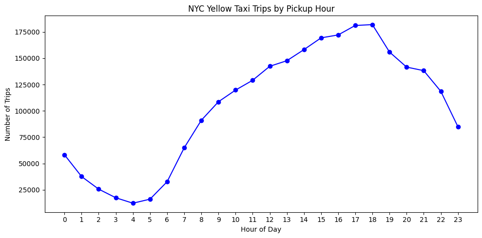
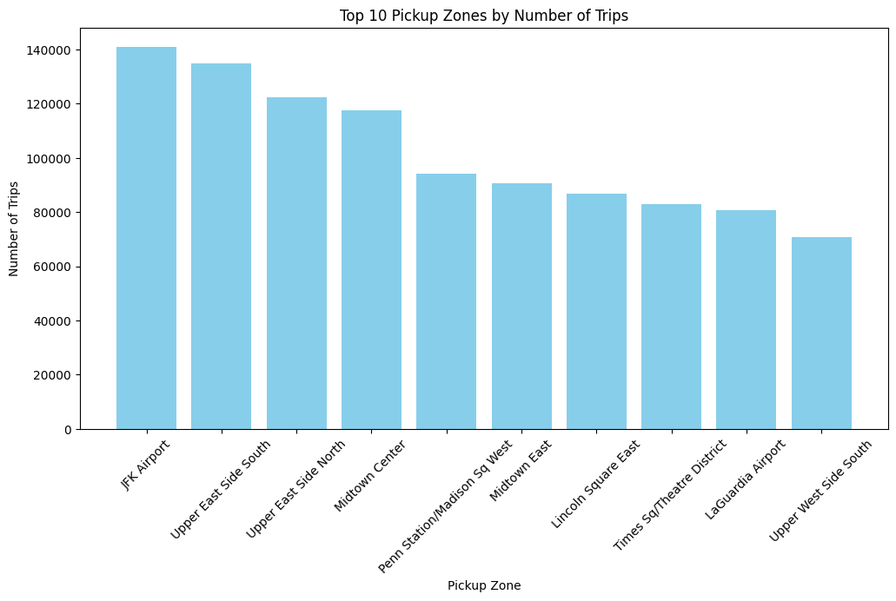
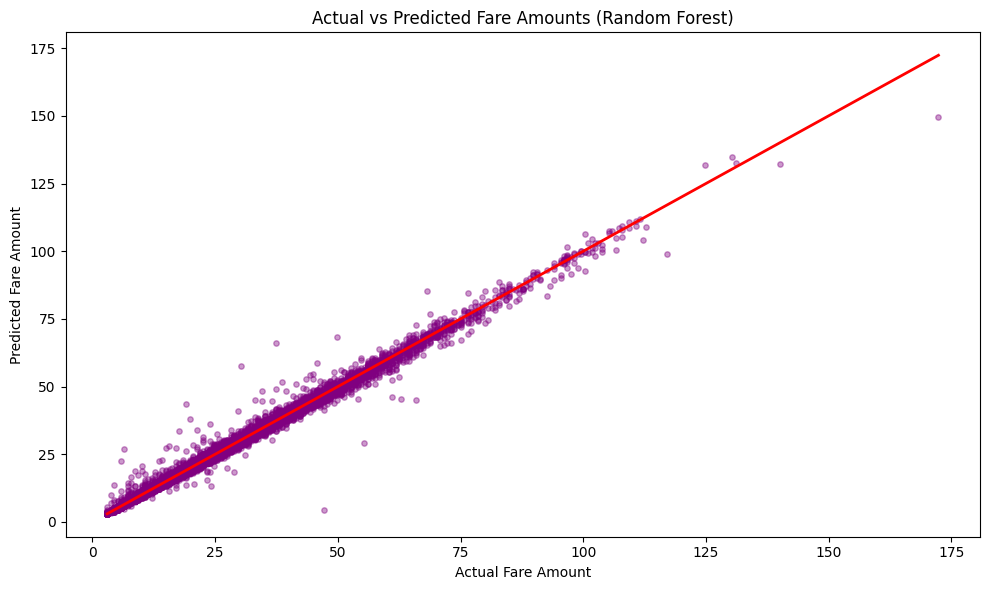
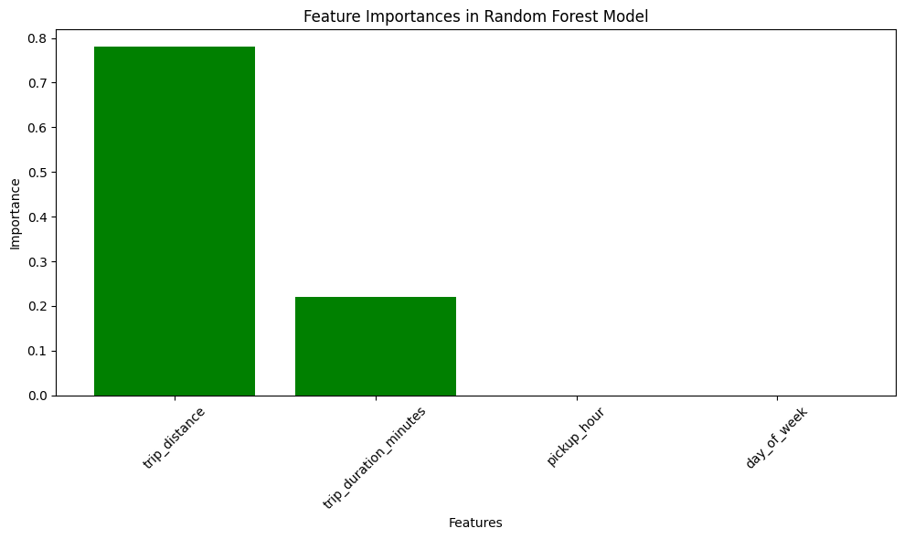

# NYC Yellow Taxi Trip Analysis & Fare Prediction

**Python · Pandas · SQLite / SQL · Matplotlib · scikit-learn · Google Colab**

An end-to-end data analytics and machine-learning project using **January 2026 NYC Yellow Taxi trip records**. The workflow explores trip demand, fare patterns and popular locations, then compares regression models for predicting the fare of a **completed standard-rate trip**.

## Project snapshot

| Measure | Result |
| --- | ---: |
| Raw trip records | **3,724,889** |
| Cleaned trip records | **2,505,946** |
| Records removed after all cleaning filters | **32.72%** |
| Busiest pickup hour | **6 PM — 181,948 trips** |
| Busiest pickup zone | **JFK Airport — 140,913 trips** |
| Best model | **Random Forest (4 features)** |
| Best model MAE / RMSE | **$0.46 / $0.91** |
| Best model R² | **0.9943** |

**[Open the complete notebook](notebooks/nyc_yellow_taxi_analysis.ipynb)** · **[Explore the SQL queries](sql/analysis_queries.sql)** · **[See model metrics (CSV)](results/model_metrics.csv)**

## Questions explored

- At what times and on which days are yellow taxi pickups most common?
- Which NYC taxi zones and pickup-to-dropoff routes are busiest?
- How do fares relate to trip distance and duration?
- Does Random Forest improve on Linear Regression, and can the model be simplified?

## Selected visualizations

### Pickup demand by hour



### Top pickup zones



### Random Forest: actual vs. predicted fare

The diagonal line indicates a perfect prediction. Points close to it have small errors.



Additional charts: [trips by weekday](figures/trips_by_day.png), [weekday vs weekend average charge](figures/weekday_vs_weekend_avg_charge.png), [distance vs fare](figures/distance_vs_fare.png), [feature importance](figures/feature_importances_rf.png), [model MAE comparison](figures/model_comparison_mae.png).

## Data sources

This project uses publicly published **NYC Taxi & Limousine Commission (TLC)** data:

- [January 2026 Yellow Taxi trip records (Parquet)](https://d37ci6vzurychx.cloudfront.net/trip-data/yellow_tripdata_2026-01.parquet)
- [Taxi zone lookup (CSV)](https://d37ci6vzurychx.cloudfront.net/misc/taxi_zone_lookup.csv)
- [NYC TLC trip-record documentation](https://www.nyc.gov/site/tlc/about/tlc-trip-record-data.page)

The raw Parquet file and generated SQLite database are **not committed** because of their size. The notebook downloads the public files when run.

## Methods

| Stage | Approach |
| --- | --- |
| Data ingestion | `pd.read_parquet`, public TLC files |
| Exploration | Data types, missingness, descriptive statistics, quantiles, outliers |
| Cleaning | January pickup-date restriction; positive fares, charges, distance, duration and passenger counts; project-defined plausibility bounds |
| Feature engineering | Trip duration, pickup hour, weekday, weekend flag, average speed |
| SQL | SQLite tables, aggregation, `CASE`, sorting, joins to taxi zones |
| Visualization | Matplotlib charts for demand, zones, fare patterns and model performance |
| Modeling | Linear Regression and Random Forest regressors |
| Evaluation | 80/20 train/test split, MAE, MSE, RMSE, R² and Random Forest feature importance |

### Data cleaning and scope

The notebook filters pickup timestamps to **January 2026** and keeps trips satisfying the following project-specific conditions:

- `0 < trip_distance <= 100` miles
- `0 < trip_duration_minutes <= 180` minutes
- `fare_amount > 0` and `total_amount > 0`
- `passenger_count > 0`
- `0 < avg_speed_mph <= 80`

After these filters, **2,505,946 of 3,724,889** raw records remain. These thresholds are analytical decisions, **not official TLC data-quality rules**.

**Important limitation:** About **29.21%** of raw records have missing `passenger_count`. The notebook's `passenger_count > 0` filter excludes those records, even though passenger count is **not** a feature in the fare model. This materially reduces the sample and could introduce selection bias. A future iteration should evaluate results without this restriction. The initial notebook's **32.71%** removal figure was calculated before the final speed filter; the final percentage is **32.72%**.

For fare prediction, the modeling subset is further restricted to **standard-rate** trips (`RatecodeID == 1`) with **cash or credit-card** payment (`payment_type` in `[1, 2]`). The descriptive SQL analyses use the broader cleaned dataset.

## Findings from SQL

- **6 PM** had the highest number of cleaned pickups: **181,948**.
- **Thursday** had the highest *total* number of trips by weekday label: **446,591**. These are totals across the month, **not per-day averages**.
- **JFK Airport** led pickup zones with **140,913 trips**, followed by Upper East Side South (**134,778**) and Upper East Side North (**122,188**).
- The most frequent zone pair was **Upper East Side South → Upper East Side North**, with **22,011 trips**.
- Manhattan accounted for **2,180,047** cleaned pickups in the borough analysis.

The zone-level sum of `total_amount` represents **total passenger charges in the filtered records**, not net revenue, driver earnings or profit.

## Machine learning

The notebook takes a reproducible **200,000-trip random sample** from the eligible standard-rate trips and uses an **80% training / 20% test** split (`random_state=42`). All three models are evaluated on the corresponding held-out test observations.

The four input features are `trip_distance`, `trip_duration_minutes`, `pickup_hour`, and `day_of_week`. The simpler model uses only the first two. Both Random Forest models use **100 trees and `max_depth=10`**.

### Held-out test results

| Model | MAE ($) ↓ | MSE ($²) ↓ | RMSE ($) ↓ | R² ↑ |
| --- | ---: | ---: | ---: | ---: |
| Linear Regression (4 features) | 0.67 | 1.37 | 1.17 | 0.9906 |
| **Random Forest (4 features)** | **0.46** | **0.83** | **0.91** | **0.9943** |
| Random Forest (2 features) | 0.47 | 0.86 | 0.93 | 0.9941 |

The **four-feature Random Forest** has the lowest test error. Removing pickup hour and weekday raises MAE by only **$0.01**. Model-specific feature importance is approximately **0.78 for distance** and **0.22 for duration**, while hour and weekday each round to **0.00**. Importance values do not establish causation.



### Interpreting the high R²

Standard metered taxi fares depend heavily on **distance and time**. Because the model receives actual completed-trip distance and duration, strong prediction accuracy is plausible. This is **post-trip fare estimation**, not an advance price quote: distance and duration are not known exactly before the ride. Results also come from a random split of one month, so performance on future months, unusual trips or different rate types is not established.

## Reproduce the analysis

**Google Colab (recommended):**

1. Download or open [`notebooks/nyc_yellow_taxi_analysis.ipynb`](notebooks/nyc_yellow_taxi_analysis.ipynb) and upload it to [Google Colab](https://colab.research.google.com/).
2. Run **Runtime → Run all**. The notebook installs `pyarrow` if needed, downloads the TLC files and creates a local `taxi.db`.
3. Allow time and memory for loading and processing several million rows and for training the forests.

**Locally (Python 3.10+):**

```bash
python -m venv .venv
source .venv/bin/activate        # Windows: .venv\Scripts\activate
pip install -r requirements.txt
jupyter notebook notebooks/nyc_yellow_taxi_analysis.ipynb
```

SQLite support comes from Python's built-in `sqlite3` module. Saved PNGs are provided in [`figures/`](figures/) so you can inspect the results without rerunning the full notebook. The notebook has saved outputs, but the revised formatting and two corrected SQL cells have **not been re-executed** in this package.

## Repository structure

```text
nyc-yellow-taxi-fare-prediction/
├── README.md
├── requirements.txt
├── .gitignore
├── GITHUB_UPLOAD_GUIDE.md
├── notebooks/
│   └── nyc_yellow_taxi_analysis.ipynb
├── sql/
│   └── analysis_queries.sql
├── figures/
│   ├── trips_by_hour.png
│   ├── top_pickup_zones.png
│   ├── actual_vs_predicted_rf.png
│   └── ... (other charts)
└── results/
    └── model_metrics.csv
```

## Limitations and future improvements

- Remove the passenger-count filter and evaluate whether the findings and performance change.
- Compare performance on a later month using a **time-based** train/test split.
- Assess error for long trips and high fares separately; a low overall MAE can hide rare large misses.
- Add pre-trip features if the goal changes to quoting a fare before a trip begins.
- Consider refining cleaning rules using TLC documentation and the distribution of trip types.

**Acknowledgment:** Data provided by the NYC Taxi & Limousine Commission. This is an independent portfolio project and is not affiliated with NYC TLC.
